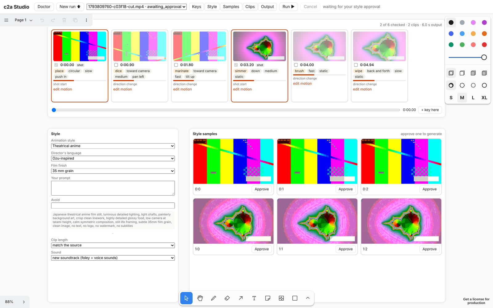

# cooking2anime
transfer the cooking video to anime styling

Turn a cooking video into a Japanese-anime video. Each **key image** (a frame that
stands for one action, scene or motion) becomes the main image of one generated clip.
You check the key images and pick a style on a canvas, and the engine does the rest.



## What it does

- **Key images, found and tagged for you:** at shot cuts and where the motion changes,
  using the sharpest nearby frame. A vision model tags each one (action, motion
  direction and speed, camera, emotion, sounds, importance) and pre-checks the best.
  You check or uncheck them, edit the tags, or add your own at any time.
- **Style in layers:** an animation style (6) + a director-inspired camera language (6)
  + a film finish (6) + your own prompt. You see samples and approve one.
- **One clip per checked key image:** image-to-video, anchored to the next key image when
  it is in the same shot. Clip length: match the source, a fixed length, or set per clip.
- **Sound:** a new soundtrack (foley + Fish Audio Drama 3 voice sounds, no narration),
  **or keep the original voice** re-timed to the key images and the new clip lengths,
  or silent.
- **Output:** 720p or 1080p, −14 LUFS, true peak ≤ −1 dBTP, and an exact frame count,
  all checked at export.

## Status

v0.2.0. The engine, the Studio and the CLI are complete and tested end to end with
**deterministic fake models** (`--stack fake`), which make real files but no real anime
look or sound. The real models (ComfyUI/Wan/Qwen locally, fal + Fish Audio in the
cloud) plug in behind the same interfaces next (milestones M3–M8 in
[docs/DEV_PLAN.md](docs/DEV_PLAN.md)). Until then `--stack local|cloud` stops with a
clear message.

## Run it

Needs `ffmpeg` (`sudo apt install ffmpeg`).

**From a release** (linux-arm64, e.g. DGX Spark or Jetson; Ubuntu 22.04+):
```sh
tar -xzf c2a-0.2.0-linux-arm64.tar.gz
./c2a-0.2.0-linux-arm64/c2a studio --stack fake
```
It prints a URL with an access token; open it in a browser. On a headless box, add
`--host 0.0.0.0` and open `http://<box-address>:8765/?token=…` from your laptop.

**From source:**
```sh
cd studio && npm ci && npm run build && cd ..    # builds the canvas into the package
pip install -e ".[dev]"
c2a studio --stack fake
```

**In the Studio:** New run ⬆ (or drop a video on the page) → check/uncheck key images →
choose style layers → **Approve** a sample → clips play on their cards as they finish
→ Output. The toolbar's Keys / Style / Samples / Clips / Output buttons move the canvas.

**Same actions from the command line:**
```sh
c2a doctor --stack fake                      # tools, GPU, API keys, with fix hints
c2a run my_cooking.mp4 --stack fake          # stops at the style approval
c2a keys runs/<id>                           # list; --check/--uncheck FRAME, --add SECONDS,
                                             #   --tags FRAME JSON, --motion FRAME "text"
c2a style --list                             # presets
c2a style runs/<id> --director ozu_inspired --finish black_white --prompt "miso soup"
c2a clips runs/<id> --mode fixed --fixed 3   # or --length FRAME SECONDS, --anchor on|off
c2a audio runs/<id> keep_voice               # regenerate | keep_voice | silent
c2a approve runs/<id> --pick 0:1             # then everything is generated
c2a status runs/<id>  ·  c2a open runs/<id>  ·  c2a rerun runs/<id> --clip k000096
```

## Docs

- Design: [docs/DESIGN_V2.md](docs/DESIGN_V2.md) (current) · [docs/DESIGN.md](docs/DESIGN.md) (v1)
- Plan and status: [docs/DEV_PLAN.md](docs/DEV_PLAN.md)
- Test rules: [docs/TESTING.md](docs/TESTING.md)
- Decisions: [docs/decisions/](docs/decisions/)
- Default config: [configs/default.yaml](configs/default.yaml)

## Tests

```sh
python -m pytest -n auto                                  # unit, property, integration, Studio API, CLI
cd studio && C2A_PYTHON=$(which python) npx playwright test  # the Studio in a real browser
```
