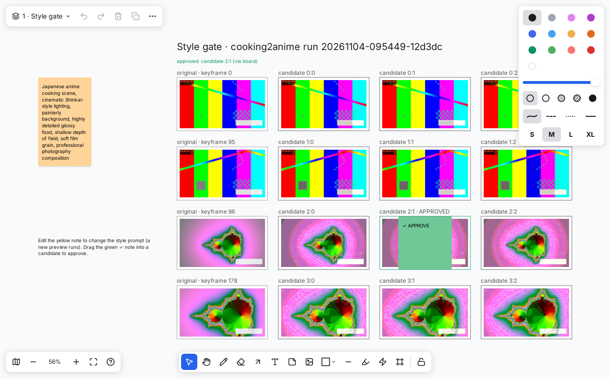

# cooking2anime
transfer the cooking video to anime styling

Input a cooking video. Get it back as Japanese anime with the same length, cuts,
motion, gestures and emotion. It has no text or logos, no narration, and a new
soundtrack (foley kitchen sounds + Fish Audio Drama 3 voice sounds). 720p or 1080p.

One human step: approve the style on a **GoDraw** canvas. Everything else is automatic,
on a local GPU (ComfyUI) or in the cloud (fal + Fish API).

```
engine (c2a.core)  ←  CLI (c2a run / watch / approve / rerun …)
        ↕ runs/<id>/board.tldr
GoDraw canvas (review, drag ✓ to approve, edit prompt notes, click ▶ to open clips)
```



## Status

The pipeline engine, CLI, GoDraw board integration and test suite are built and pass in
CI, running end to end with **deterministic fake providers** (`--stack fake`). The real
model backends (ComfyUI/Wan/Qwen, fal, Fish Audio) are the next milestones (M3–M7 in
[docs/DEV_PLAN.md](docs/DEV_PLAN.md)); until then `--stack local|cloud` stops with a
clear message.

## Quickstart (fake stack)

Needs Python ≥ 3.12 and ffmpeg. GoDraw is optional (boards are plain `.tldr` files).

```sh
pip install -e ".[dev]"
c2a doctor --stack fake
c2a run my_cooking.mp4 --stack fake        # stops at the style gate, prints the board path
c2a board open runs/<id>                   # GoDraw: drag ✓ APPROVE into a candidate …
c2a watch runs/<id>                        # … and the run continues by itself
#   or headless:  c2a approve runs/<id> --pick 1:0
c2a status runs/<id>
c2a open runs/<id>                         # final video in the system player
c2a rerun runs/<id> --chunk 0.1            # re-generate one chunk with a new seed
```

Config: [configs/default.yaml](configs/default.yaml), overridable with
`--set output.resolution=1080p` etc.

## Builds

The `build linux-arm64` workflow produces, for linux/arm64:

- `c2a-<version>-linux-arm64.tar.gz`: self-contained CLI (PyInstaller, built on Ubuntu
  22.04 so it runs on glibc ≥ 2.35, e.g. Ubuntu 22.04+, DGX OS, Jetson JetPack 6).
  Needs `ffmpeg` on the target.
- `godraw-linux-arm64`: GoDraw at the pinned commit (needs GTK3 on the target).
- `cooking2anime-<version>-py3-none-any.whl`.

It builds natively when the repository variable `ARM64_RUNNER` names an arm64 runner,
otherwise in an arm64 container under QEMU. Tags `v*` publish a GitHub release.

## Docs

- Design: [docs/DESIGN.md](docs/DESIGN.md)
- Development plan + status: [docs/DEV_PLAN.md](docs/DEV_PLAN.md)
- Test rules: [docs/TESTING.md](docs/TESTING.md)

## Tests

```sh
cd tools/tldr-validate && npm ci && cd -                 # tldraw schema validator
python -m pytest                                         # unit, property, integration, board
C2A_GODRAW_E2E=/path/to/godraw-e2e xvfb-run -a python -m pytest tests/godraw   # real GoDraw
python tools/coverage_gate.py coverage.json
```
