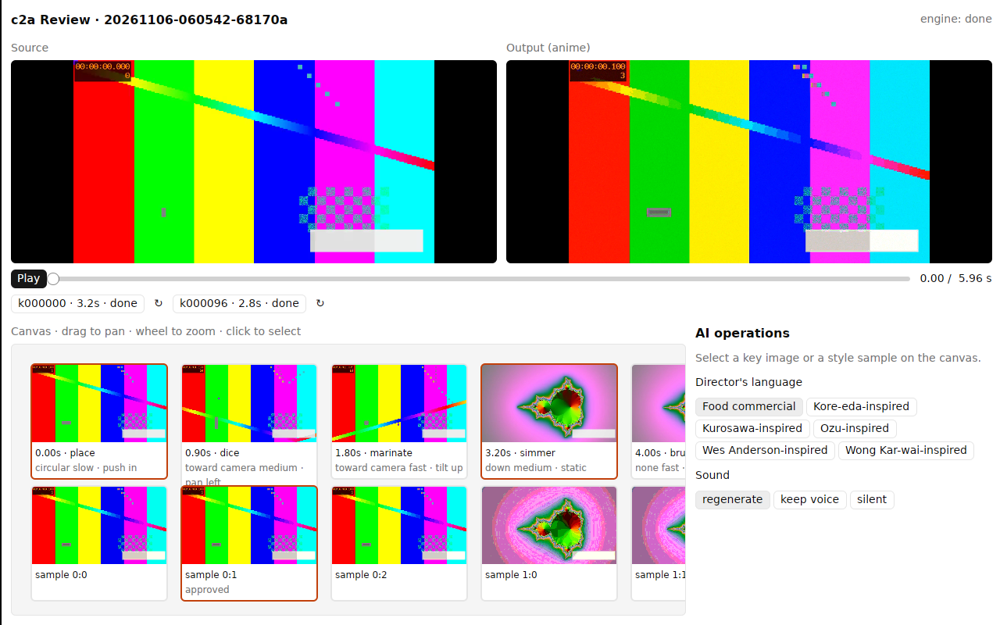

# Research: GPUI Kit for a native c2a review app

Branch `claude/research-gpui-kit-demo`. Question: can [GPUI Kit](https://gpui-kit.com/)
(Rust, GPU-drawn UI) host the three things c2a Studio does — **play and review video**,
**an image canvas** of key images and style samples, and **AI operations** on the engine?

**Answer: yes, for all three.** The demo (`c2a-review`) runs against a real `c2a studio`
and drives the engine with the same typed commands the web Studio uses. Video was
the only hard part, and it needed a small port (below).

## What the demo does

| Area | Built with | Verified |
|------|-----------|----------|
| Play / review | Two synced players (source, anime output), Play/Pause, a scrub slider, per-clip seek buttons. Output time is mapped to source time per clip (clips may be shorter or longer than their source span). | Plays under Xvfb, the slider follows playback, and the source re-seeks when it drifts more than 0.3 s from the clip mapping |
| Image canvas | Key-image cards (row 1, tags shown) and style-sample cards (row 2) on a pan/zoom surface: drag to pan, wheel zooms about the cursor, click selects | Selecting a card fills the AI-operations panel |
| AI operations | Check or uncheck a key image (`toggle_key`), approve a sample (`approve`), director preset (`set_style`), sound mode (`set_audio`), re-run a clip (`rerun`) | Checking the 0.90 s key made the engine re-plan from 2 to 3 clips and start generating ([screenshot](docs/ai-operation.png)) |

The demo reimplements no engine logic. It reads `GET /api/runs/{id}` (the same view model
the tldraw Studio draws) every 1.5 s, reads media files from the run folder, and
sends `POST /api/runs/{id}/commands`. These calls go through `c2a.app`, as the CLI does.

## Findings

1. **GPUI Kit 0.9.0** (Apache-2.0) is a facade over **`gpui-pre =0.3.11`**:
   - `gpui_kit::*` re-exports GPUI;
   - components live under `gpui_kit::component::*`;
   - `gpui_kit::open_window` wraps the root view.

   The component set covers everything this app needs: Button, Slider, Checkbox,
   scroll areas, theming. Gaps were small:
   - `Disableable` and `Selectable` must be imported to call `.disabled()` and `.selected()`;
   - `on_scroll` / `ScrollEvent` replace the deprecated wheel API;
   - `paint_image` takes the bounds first.
2. **No video player ships with GPUI Kit.** Every published GPUI video crate pins a
   different GPUI, so none links next to gpui-kit 0.9:

   | Crate | GPUI it pins |
   |-------|--------------|
   | `alhazen-gpui` 0.7.1 | `gpui` 0.2.2 |
   | `alhazen-gpui-pre` | `gpui-pre =0.3.8` |
   | `alhazen-ms-gpui` | `gpui-pre =0.3.10` |

   **Fix used:** a port of `alhazen-gpui`'s element and player, about 570 lines in
   `src/video/` (Apache-2.0, attribution kept), onto the UI-agnostic `alhazen-core 0.7.1`.
   The port must be bumped each time GPUI Kit bumps gpui-pre. **This is the main maintenance risk.**
3. **Decoding.** `alhazen-core` decodes H.264 on Linux through the system `ffmpeg`
   (feature `ffmpeg-cli`), or NVDEC when present. c2a already requires ffmpeg, so this
   adds nothing new. Audio goes through ALSA. In a container with no sound card, it logs
   "Unknown PCM default" and plays silently.
4. **Linux build.** Needs:
   - `libxkbcommon-dev`, `libxkbcommon-x11-dev`, `libasound2-dev`;
   - a Vulkan driver at run time.

   The first build of the dependency tree takes several minutes and `target/` is about
   1.5 GB. The incremental rebuild of the app itself takes a few seconds.
5. **Headless and CI.** It renders under `Xvfb` with Mesa lavapipe (`mesa-vulkan-drivers`,
   software Vulkan). That is enough for screenshot tests in GitHub Actions. Clicks were
   scripted with `xdotool`.
6. **Bug found and fixed.** `cx.active_window()` returns `None` when the window is not
   focused, which is always the case under Xvfb without a window manager. The slider then
   never moved. Fix: run the playback tick with `spawn_in(window)` / `update_in`, so it
   always gets its own window.

## Performance: canvas stress test vs tldraw

[`bench/`](bench/README.md) runs one scripted session on both stacks:
- N image cards and a 1080p video playing;
- pan, then zoom out to 0.08× (most cards on screen);
- drag 200 selected cards;
- duplicate them 8 times (+1600 cards).

Measured in the cloud container: 4 vCPU, **no GPU**. Both stacks draw in software
(Mesa lavapipe for GPUI, SwiftShader/Skia for Chromium).

The key number is **UI-thread CPU per frame**. That is the work no GPU can take over:
- for GPUI: layout and building the frame;
- for tldraw: JS, React and the DOM.

At 60 fps the budget is 16.7 ms.

| UI-thread ms per frame | GPUI (culled), 1k cards | tldraw, 1k cards | GPUI (culled), 5k cards | tldraw, 5k cards |
|---|---|---|---|---|
| idle | 2.3 | 0.5 | 2.5 | 0.7 |
| pan | 2.6 | 7.0 | 2.6 | 10.2 |
| zoom out to 0.08× | 7.7 | 18.9 | 9.2 | 33.5 |
| drag 200 cards | 4.6 | 17.7 | 5.0 | 42.6 |
| duplicate 200 cards ×8 | 14.6 | 62.7 | 15.2 | 233 |

| What you see in tldraw (frames are paced by Chromium at 60 Hz) | 1k cards | 5k cards |
|---|---|---|
| zoom out: fps / worst frame | 33 / 233 ms | 21 / 367 ms |
| drag: fps / worst frame | 54 / 33 ms | 23 / 100 ms |
| duplicate: fps / worst frame | 11 / 350 ms | 3.3 / 483 ms |
| memory (all Chromium processes) | 1.75 GB | 2.1 GB |

**Results:**
- **GPUI's UI-thread work stays under the 60 fps budget in every phase, and barely
  changes from 1k to 5k cards (6.6k after duplication).**
- tldraw is fine for idle and pan. With 1k+ cards it misses the budget on zoom-out,
  drag and duplicate, and the misses grow with the card count: 4× slower than GPUI
  on drag at 1k, 8× at 5k, and 15× on duplicate at 5k.
- tldraw also refuses more than **4000 shapes per page by default** (`maxShapesPerPage`).
  The 5k run had to raise that limit.
- Memory: GPUI uses 0.7–0.78 GB for the same scene (500 decoded thumbnails, the video, and
  the software rasterizer), against 1.75–2.1 GB for Chromium.
- **Culling is required in GPUI.** Without it, every card is laid out each frame and the UI
  thread needs 48 ms per frame at 5k cards. With a 5-line viewport check it needs 2.5 ms.
  tldraw culls internally. A real app also needs a spatial index for hit testing.

**What this container cannot show:**
- **GPUI's real frame rate.** GPUI is held at about 21 fps here even with an empty window,
  because its presentation through software Vulkan under Xvfb is paced at 48 ms. Mesa's
  `llvmpipe` threads use 0.7–2 cores to rasterize every frame. On a real GPU that work
  moves to the GPU, which is GPUI's main advantage, but it is **not measured yet**.
- **GPUI's video smoothness.** The decoder kept up (ffmpeg used about 0.35 cores), but the
  display was capped by the same pacing. Chromium showed the 1080p clip with 0 dropped frames.

**Fairness notes:**
- tldraw's duplicate also does more work: undo history, bindings and indexes.
- GPUI's figures are for a bare canvas. Undo, hit testing and saving would add UI-thread
  work, but in code we control and can optimize.

**Next check:** one run of `bench/run-all.sh` on a desktop with a GPU (macOS Metal, or Linux
with a real Vulkan driver), to confirm the frame rate and video smoothness.

## Compared with the tldraw Studio (v0.2.0)

| | GPUI Kit native app | tldraw web Studio |
|---|---|---|
| Video | Frame-accurate GPU decode and drawing. Two synced players are easy, and long clips stay smooth. | `<video>` elements in shapes. Fine, but sync and frame stepping rely on browser seeking. |
| Canvas | Built by hand: pan, zoom and cards are about 100 lines. Arrows, free drawing, notes, undo and multiplayer would all have to be written. | All of that comes free (arrows, notes, undo, persistence). |
| Distribution | One native binary per OS. Linux arm64 needs a Vulkan driver. | Any browser; ships inside the `c2a` binary. |
| Tests | Rust unit tests, plus Xvfb screenshot tests | Playwright e2e, already in CI |
| Maintenance | The video port follows gpui-pre bumps. GPUI Kit is pre-1.0. | tldraw is mature, but licensing needs a key in production (ADR-006). |

## Recommendation

**If the product needs a large canvas** (thousands of images, with bulk move, duplicate
and zoom-out while video plays), **GPUI Kit is feasible and the stronger base.** On the
same scripted session, its UI-thread work was 3–15× lower than tldraw's. It stayed within
the 60 fps budget at 5k+ cards, where tldraw dropped to 3–23 fps. It also used about a third
of the memory.

The costs are known and bounded:
- we build the canvas features ourselves: culling and a spatial index from day one, then
  selection, undo and saving;
- we maintain the video port, which must follow each GPUI Kit bump.

**For a small board** (tens to hundreds of cards: today's Studio), tldraw remains the
faster path to features and is not a bottleneck.

Before committing:
1. Run `bench/run-all.sh` once on real GPU hardware (Mac, or Linux with a Vulkan driver)
   to confirm frame rate and video smoothness.
2. Move the video port into its own crate, pinned with GPUI Kit.
3. Add an Xvfb + lavapipe screenshot job to CI.
4. Check macOS (Metal) and Windows builds.

Both front ends speak the same `/api/runs` contract, so the engine does not change either way.
